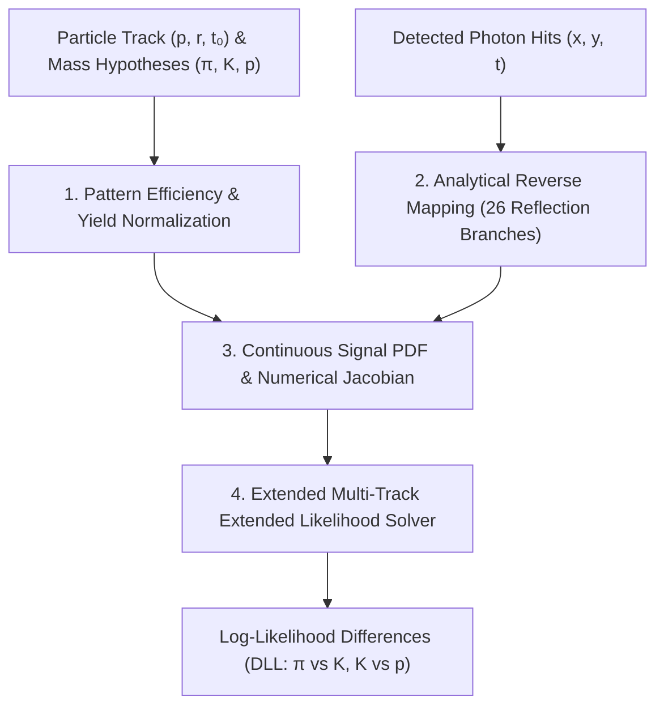

# Unbinned PID Algorithm

## Overview

The **Unbinned Particle Identification (PID)** algorithm is the core analytical likelihood reconstruction framework for the TORCH detector. Unlike binned reconstruction methods that rasterize photon hits into discrete spatio-temporal pixel histograms ($N_t \times N_y \times N_x$), the unbinned algorithm calculates exact continuous probability densities directly from the $(x, y, t)$ coordinates of each detected photon hit.

This eliminates binning edge effects, preserves sub-pixel spatial resolution and picosecond-level timing precision, and naturally handles overlapping particle tracks and module-level background noise.

---

## 1. Physical Model & Hypotheses

For a charged track $t$ traversing the quartz radiator plate with momentum magnitude $p$ and direction vector $\hat{u}$, particle identification aims to distinguish between mass hypotheses: $h \in \{\pi, K, p, e, \mu\}$

For each hypothesis with rest mass $m_h$, the relativistic parameters are: $\beta = \frac{p}{\sqrt{p^2 + m_h^2}}, \quad \gamma = \frac{1}{\sqrt{1 - \beta^2}}$

Cherenkov radiation is produced at the characteristic polar angle $\theta_c(E)$ given by the material phase refractive index $n_{\text{phase}}(E)$: $\cos\theta_c(E) = \frac{1}{\beta \, n_{\text{phase}}(E)}$

Radiation is emitted only above the Cherenkov threshold: $\beta \cdot n_{\text{phase}}(E) > 1$.

---

## 2. Pattern Efficiency & Expected Signal Yields

The expected number of detected photons $\mu_{t,h}$ for track $t$ under hypothesis $h$ is required to normalize the extended likelihood mixture:

1. **Spectral Yield**: The Frank-Tamm formula integrated over the transmission bandwidth $[E_{\text{min}}, E_{\text{max}}]$ yields the raw emission density per unit pathlength: $\frac{dN}{dx} = 37.0 \int_{E_{\text{min}}}^{E_{\text{max}}} \sin^2\theta_c(E) \, \varepsilon_{\text{det}}(E) \, dE \quad [\text{photons / mm}]$
2. **Geometric Acceptance (`pattern_efficiency`)**: Ray-tracing a small sample ($N_{\text{gen}} \sim 1000$) of Monte Carlo photons from the track trajectory determines the geometric acceptance and optics transmission efficiency $\varepsilon_{t,h}$: $\varepsilon_{t,h} = \frac{N_{\text{detected}}}{N_{\text{gen}}}$
3. **Expected Yield**: $\mu_{t,h} = \left(\frac{dN}{dx} \cdot L_{\text{track}}\right) \times \varepsilon_{t,h}$ where $L_{\text{track}} = \frac{d_{\text{radiator}}}{u_z}$ is the trajectory pathlength through the radiator thickness.

---

## 3. Analytical Reverse Mapping

Rather than simulating millions of forward ray-traced photons during event reconstruction, the algorithm takes each detected hit $i$ with coordinates $(x_i, y_i, t_i)$ and **inverts the optical path** backwards to the particle track.

### 3.1 Cylindrical Mirror Inversion

The hit vertical coordinate $y_i$ on the MCP detector plane maps uniquely to the photon's exit angle and optical path in the cylindrical focusing block: $\text{slope}(y_i) = \sum_{k=0}^4 c_k^{\text{slope}} y_i^k, \quad y_{\text{path}}(y_i) = \sum_{k=0}^4 c_k^{\text{path}} y_i^k + H_{\text{radiator}} - y_{\text{wedge}}$

### 3.2 Reflection Branch Unfolding

Light can undergo internal reflections before entering the focusing block:

  * **$y$-direction reflections** ($k_y \in \{1, 2\}$):

      * $$
        k_y = 1
        $$

        : Direct upward path toward the mirror ($y_{\text{dist}} = y_{\text{path}} - y_0$).
      * $$
        k_y = 2
        $$

        : Reflected from the bottom edge of the radiator bar ($y_{\text{dist}} = -y_{\text{path}} - y_0$).
  * **$x$-direction reflections** ($m \in [-N_x, N_x]$):

      * Up to $N_x = 6$ reflections off the left or right side walls.
      * Virtual unfolded position: $x_{\text{unfolded}} = \begin{cases} m \cdot W - x_i - x_0 & \text{if } m \text{ is odd} \\ m \cdot W + x_i - x_0 & \text{if } m \text{ is even} \end{cases}$

This defines $2 \times 13 = \mathbf{26}$ discrete optical branches.

### 3.3 Reconstructed Cherenkov Angle & Arrival Time

For each branch, the photon pathlength $L$ and direction $\hat{d} = (d_x, d_y, d_z)$ from the track emission point are computed analytically in closed form. The Cherenkov angle is then: $\cos\theta_c = \hat{d} \cdot \hat{u}_{\text{track}}$

A branch hypothesis is valid if and only if:

1. $$
    n_{\text{phase}} = \frac{1}{\beta \cos\theta_c} \in [n_{\text{min}}, n_{\text{max}}]
    $$

    .
2. Total Internal Reflection (TIR) conditions are satisfied: $1 - d_z^2 > \left(\frac{n_{\text{air}}}{n_{\text{phase}}}\right)^2, \quad 1 - d_y^2 > \left(\frac{n_{\text{air}}}{n_{\text{phase}}}\right)^2, \quad 1 - d_x^2 > \left(\frac{n_{\text{air}}}{n_{\text{phase}}}\right)^2$
3. The reconstructed arrival time matches the hit time within the acceptance gate $|t_{\text{reco}} - t_i| < \Delta t_{\text{window}}$: $t_{\text{reco}} = t_0 + \frac{L_{\text{track}}}{\beta c} + \frac{L}{v_{\text{group}}(E)}$

---

## 4. Continuous Signal PDF & Coordinate Jacobian

For each valid branch, the reconstructed Cherenkov emission angle and energy are mapped to the detector coordinates. The signal probability density requires the coordinate transformation Jacobian from $(E, \phi_c)$ emission space to $(x, y)$ detector hit space:

$$
J = \left|\frac{\partial(x, y)}{\partial(E, \phi_c)}\right| = \left| \frac{\partial x}{\partial E}\frac{\partial y}{\partial \phi_c} - \frac{\partial x}{\partial \phi_c}\frac{\partial y}{\partial E} \right|
$$

Evaluated numerically using central finite-differencing:

  * Energy step: $\Delta E = 1 \text{ meV}$
  * Azimuthal step: $\Delta \phi_c = 10^{-6} \text{ rad}$

The total signal probability density is summed over all valid branches: $S(x_i, y_i, t_i \mid \text{track } t, h) = \sum_{\text{branches}} \frac{P(E) \cdot P(t_i \mid t_{\text{reco}})}{2\pi \cdot J \cdot \varepsilon_{t,h}}$

where $P(E) = \frac{\sin^2\theta_c(E) \varepsilon_{\text{det}}(E)}{\int \sin^2\theta_c \varepsilon_{\text{det}} dE}$ and $P(t_i \mid t_{\text{reco}}) = \frac{1}{\sqrt{2\pi}\sigma_t(L)} \exp\left(-\frac{(t_{\text{reco}} - t_i)^2}{2\sigma_t^2(L)}\right)$ with pathlength-dependent chromatic timing resolution $\sigma_t(L) = \sigma_0 + \alpha L$.

### Pixel Hit Quadrature

For digitized `PixelHit` data with finite pixel dimensions $(\Delta x, \Delta y)$, the spatial density is integrated over the pixel area using a 9-point Gaussian quadrature: $S_{\text{pixel}} = \sum_{q=1}^9 w_q \, S(x_q, y_q, t_i \mid t, h) \cdot \Delta x \, \Delta y \, \Delta t$

---

## 5. Multi-Track Extended Likelihood Solver

When multiple charged tracks traverse the same TORCH module in an event, their Cherenkov photon rings overlap on the MCP plane along with background noise.

1. **Mixture Model**: For a module with $N_{\text{hits}}$ hits and $N_{\text{tracks}}$ tracks, given hypothesis vector $\vec{h} = (h_1, h_2, \dots, h_{N_{\text{tracks}}})$: $P_i(\vec{h}) = \frac{\mu_{\text{bkg}}}{N_{\text{hits}}} B(x_i, y_i, t_i) + \sum_{t=1}^{N_{\text{tracks}}} \frac{\mu_{t, h_t}}{N_{\text{hits}}} S(x_i, y_i, t_i \mid t, h_t)$ where $B(x_i, y_i, t_i) = \frac{1}{A_{\text{det}} \Delta t}$ is the flat background model and: $\mu_{\text{bkg}} = \max\left(N_{\text{hits}} - \sum_{t=1}^{N_{\text{tracks}}} \mu_{t, h_t}, \, 1\right)$
2. **Extended Log-Likelihood**: $\ln \mathcal{L}(\vec{h}) = \sum_{i=1}^{N_{\text{hits}}} \ln P_i(\vec{h})$
3. **Coordinate-Ascent Optimization**: Tracks are optimized iteratively (typically 3 iterations). In each iteration, all other tracks keep their current best hypothesis while track $t$ tests every mass hypothesis $h \in \{\pi, K, p\}$ to compute: $\ln \mathcal{L}(t, h) = \ln \mathcal{L}(h_1^*, \dots, h_t = h, \dots, h_{N_{\text{tracks}}}^*)$
4. **Delta Log-Likelihood (DLL)**: The final particle identification observables are the Delta Log-Likelihood differences: $\Delta \ln \mathcal{L}_{K - \pi} = \ln \mathcal{L}(K) - \ln \mathcal{L}(\pi)$ $\Delta \ln \mathcal{L}_{p - \pi} = \ln \mathcal{L}(p) - \ln \mathcal{L}(\pi)$

---

## 6. Implementation & Architecture in `TorchPID.jl`

The Julia implementation is optimized for high-throughput zero-allocation execution:

| Module / Struct                | Purpose                                               | Key Optimization                                                                                          |
|:------------------------------ |:----------------------------------------------------- |:--------------------------------------------------------------------------------------------------------- |
| `UnbinnedPIDWorkspace`         | Thread-local scratchpad for single-module evaluation  | Reusable contiguous arrays for `yields`, `sig_prob`, `slopes`, `ypaths` (**0 bytes allocated per event**) |
| `ReverseMappingConfig`         | Inversion polynomials & reflection bounds             | Pure `isbits` `NTuple{5, Float64}` in CPU registers                                                       |
| `accumulate_hit_signal_probs!` | Branch unfolding & multi-hypothesis signal evaluation | Fused $\beta$-independent path evaluation once across all mass hypotheses                                 |
| `solve_unbinned_likelihoods!`  | Multi-track coordinate-ascent solver                  | In-place log-sum sweeps avoiding temporary matrix allocations                                             |
| `ModulePIDWorkspace`           | 18-module detector event partitioner & dispatcher     | In-place module grouping with LPT dynamic work-stealing                                                   |
| `run_unbinned_pid_batch!`      | Multi-event concurrent reconstruction                 | Event-level multi-threading across CPU cores                                                              |

